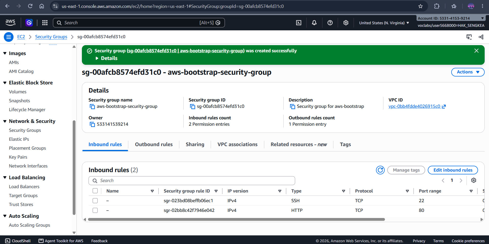
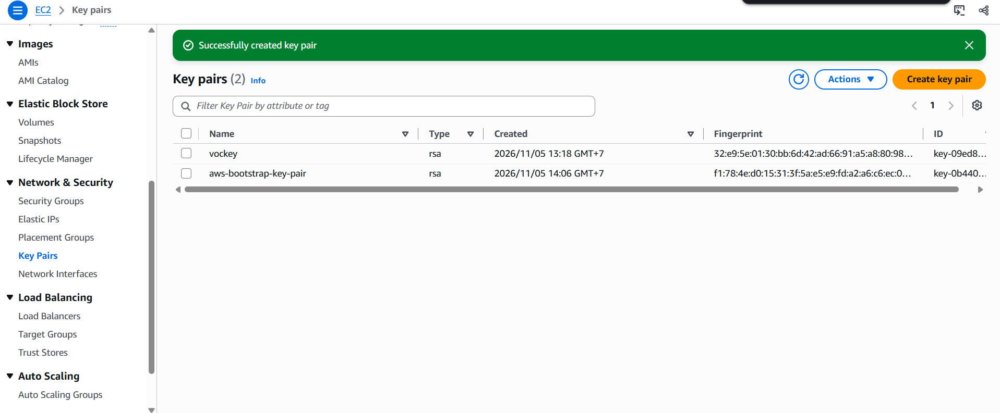
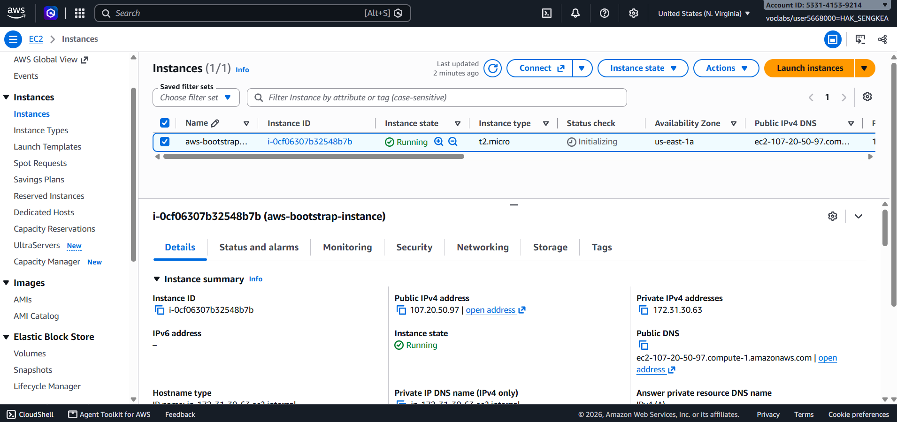
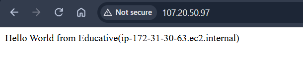
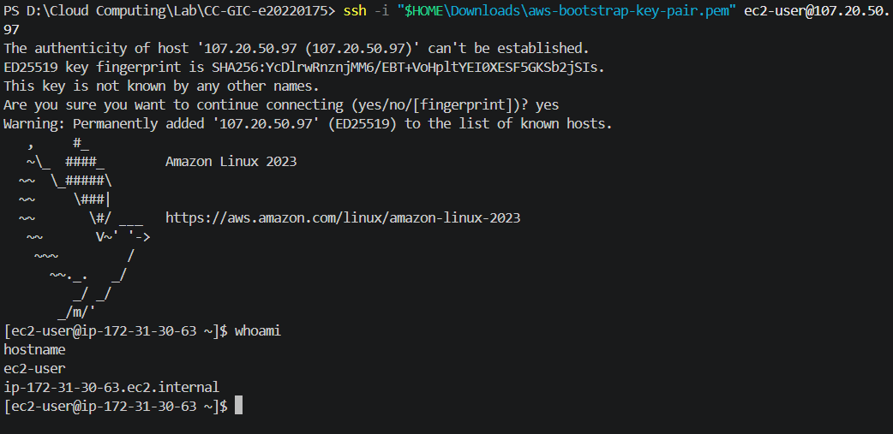
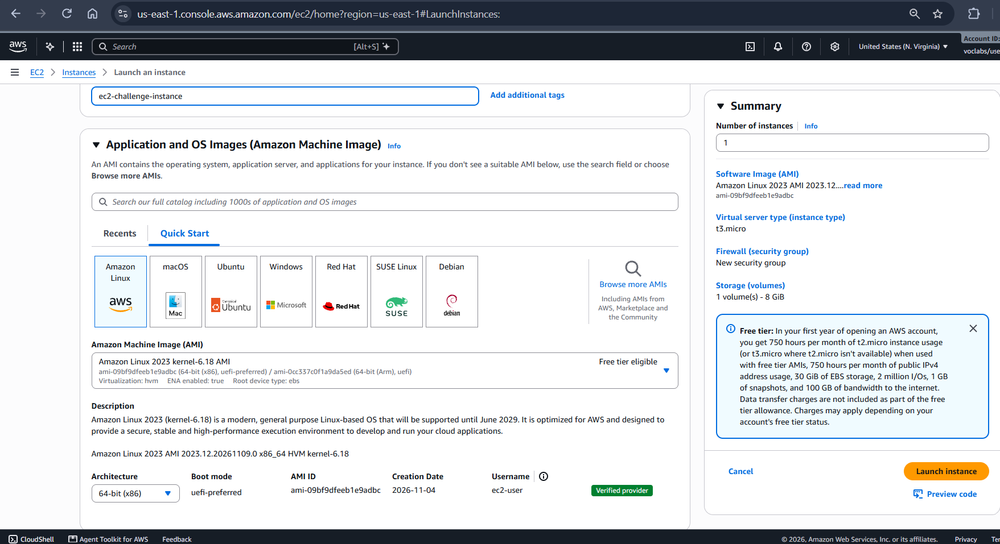
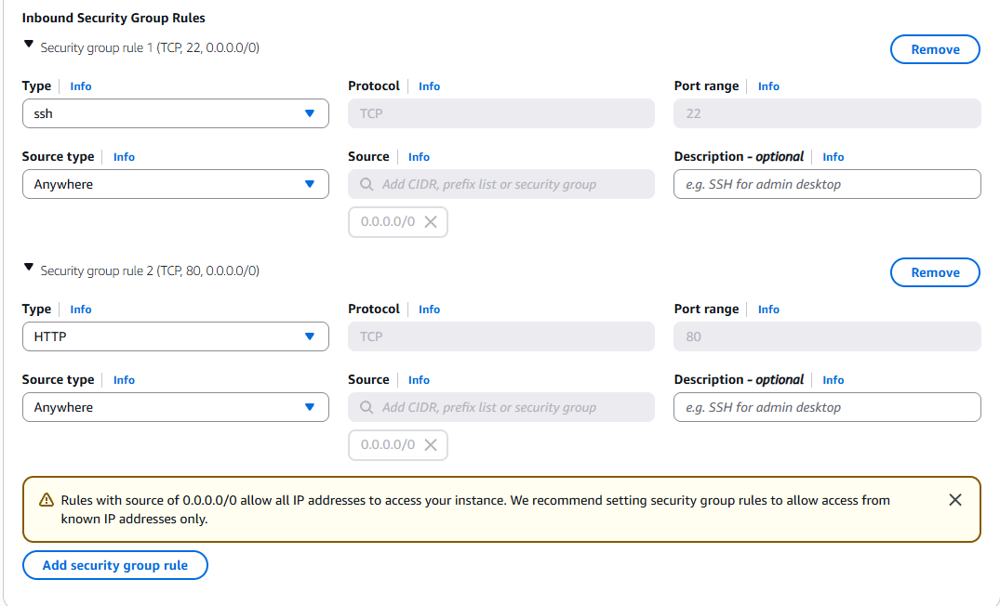
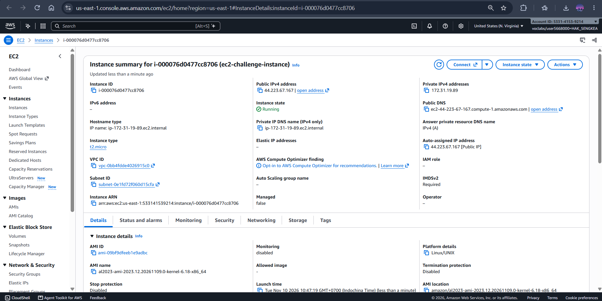
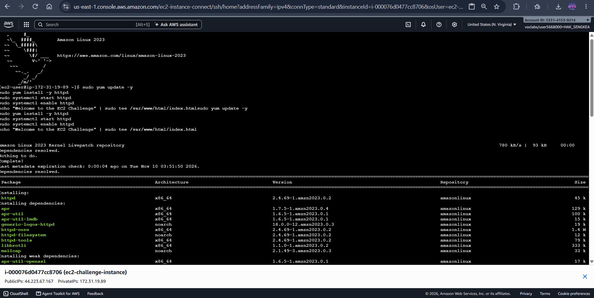
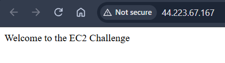

# Cloud Lab 1 — Amazon EC2 (Hands-on) Report

| Item | Details |
|---|---|
| **Student Name** | Hak Sengkea |
| **Student ID** | `e20220175` |
| **Learner Lab User** | `voclabs/user5668000=HAK_SENGKEA` |
| **Course** | GICI5CC — Introduction to Cloud Computing (2025–2026) |
| **Instructor** | Heng Rathpisey |
| **Region** | US East (N. Virginia) `us-east-1` |

---

## Overview & Objectives

Amazon Elastic Compute Cloud (Amazon EC2) launches virtual server instances in the AWS cloud to host web applications and other workloads. In this lab, I completed two parts:
1. **Part 1.1 — An Amazon EC2 Walkthrough:** Created a security group allowing SSH and HTTP traffic, generated an RSA key pair, launched an Amazon Linux 2023 `t2.micro` EC2 instance bootstrapped with an Apache (`httpd`) user data script, and verified connectivity via browser (HTTP) and SSH.
2. **Part 1.2 — Set Up an EC2 Web Solution (Challenge):** Independently provisioned and configured a secure `t2.micro` EC2 instance with a 10 GiB root EBS volume, configured inbound HTTP and SSH firewall rules, connected via EC2 Instance Connect, installed and enabled Apache (`httpd`), and served the custom static page *"Welcome to the EC2 Challenge"*.

---

# Part 1.1 — An Amazon EC2 Walkthrough

## Task 1 — Create a Security Group

I created a security group named `aws-bootstrap-security-group` in the default VPC (`us-east-1`) acting as an instance-level firewall with the following rules:
- **Inbound Rules:**
  - **SSH (TCP port 22):** Source `0.0.0.0/0` (Anywhere-IPv4) for remote terminal administration.
  - **HTTP (TCP port 80):** Source `0.0.0.0/0` (Anywhere-IPv4) for web browser access.
- **Outbound Rules:** Allow all outbound traffic (`0.0.0.0/0`).



---

## Task 2 — Create a Key Pair

I created an RSA key pair named `aws-bootstrap-key-pair` in `.pem` format for SSH authentication and stored the private key outside the Git repository.



---

## Task 3 — Launch an Instance

I configured and launched the EC2 instance with the following parameters:

| Setting | Value |
|---|---|
| **Instance Name** | `aws-bootstrap-instance` |
| **Instance ID** | `i-0cf06307b32548b7b` |
| **AMI** | Amazon Linux 2023 AMI (`64-bit x86`) |
| **Instance Type** | `t2.micro` |
| **Key Pair** | `aws-bootstrap-key-pair` |
| **Security Group** | `aws-bootstrap-security-group` |
| **Root Storage** | `8 GiB gp3` (EBS) |
| **Public IPv4 Address** | `107.20.50.97` |
| **Private IPv4 Address** | `172.31.30.63` |

### Bootstrap User Data Script

```bash
#!/bin/bash
sudo su
yum update -y
yum install -y httpd.x86_64
systemctl start httpd.service
systemctl enable httpd.service
echo "Hello World from Educative($(hostname))" > /var/www/html/index.html
```



---

## Task 4 — Test the Instance

### Approach 1 — Browser (HTTP)

Opening `http://107.20.50.97` in the browser returned the bootstrapped web page displaying `Hello World from Educative(ip-172-31-30-63.ec2.internal)`.



### Approach 2 — SSH Connection

I connected to the instance over SSH from PowerShell using the downloaded `.pem` key pair and verified the user and hostname:

```powershell
ssh -i "$HOME\Downloads\aws-bootstrap-key-pair.pem" ec2-user@107.20.50.97
```

Commands executed inside the instance:
```bash
whoami
# Output: ec2-user

hostname
# Output: ip-172-31-30-63.ec2.internal
```



---

## Clean Up (Part 1.1)

After capturing screenshots `01` through `05`, I terminated `aws-bootstrap-instance`, deleted `aws-bootstrap-key-pair`, and deleted `aws-bootstrap-security-group`.

---

# Part 1.2 — Set Up an EC2 Web Solution (Challenge)

## Challenge Configuration Summary

| Requirement | Configuration Used |
|---|---|
| **Instance Name** | `ec2-challenge-instance` |
| **Instance ID** | `i-000076d0477cc8706` |
| **AMI** | Amazon Linux 2023 AMI (`al2023-ami-2023.12.20261109.0-kernel-6.18-x86_64`) |
| **Instance Type** | `t2.micro` |
| **Public IPv4 Address** | `44.223.67.167` (Auto-assigned public IP enabled) |
| **Private IPv4 Address** | `172.31.19.89` |
| **Security Group** | `challenge-security-group` — Inbound **SSH (22)** and **HTTP (80)** from `0.0.0.0/0` |
| **Storage (Root Volume)** | **10 GiB** `gp3` EBS volume |
| **Web Server** | Apache HTTP Server (`httpd`) serving `/var/www/html/index.html` |

---

## Step 1 — Instance Launch & AMI Selection

I configured the instance name `ec2-challenge-instance` and selected the **Amazon Linux 2023 AMI (64-bit x86)** on a `t2.micro` instance with a **10 GiB** root volume.



---

## Step 2 — Security Group Configuration

I configured the security group to allow inbound **SSH (port 22)** for remote administration and **HTTP (port 80)** for web access from `0.0.0.0/0`.



---

## Step 3 — Running Challenge Instance

Once launched, `ec2-challenge-instance` (`i-000076d0477cc8706`) entered the **Running** state with public IPv4 address `44.223.67.167`.



---

## Step 4 — Installing Apache & Creating `index.html`

I connected to `ec2-challenge-instance` via **EC2 Instance Connect** and ran the following commands to update packages, install and start Apache (`httpd`), enable it on boot, and create `/var/www/html/index.html`:

```bash
sudo yum update -y
sudo yum install -y httpd
sudo systemctl start httpd
sudo systemctl enable httpd
echo "Welcome to the EC2 Challenge" | sudo tee /var/www/html/index.html
```

| Command | Explanation |
|---|---|
| `sudo yum update -y` | Updates system packages to the latest versions |
| `sudo yum install -y httpd` | Installs the Apache HTTP web server package |
| `sudo systemctl start httpd` | Starts the Apache web server daemon immediately |
| `sudo systemctl enable httpd` | Configures Apache to start automatically on system boot |
| `echo "Welcome to the EC2 Challenge" \| sudo tee /var/www/html/index.html` | Writes the required message to `/var/www/html/index.html` with root permissions |



---

## Step 5 — Browser Verification

Navigating to `http://44.223.67.167` in the browser displayed the **Welcome to the EC2 Challenge** page hosted on the EC2 instance.



---

## Clean Up (Part 1.2)

After verifying the web page and taking all screenshots (`06`–`10`), I terminated `ec2-challenge-instance` and deleted its associated security group and key pair.
