# Cloud Lab 2 — Application Load Balancer with an EC2 Auto Scaling Group Report

| Item | Details |
|---|---|
| **Student Name** | Hak Sengkea |
| **Student ID** | `e20220175` |
| **Learner Lab User** | `voclabs/user5668000=HAK_SENGKEA` |
| **Course** | GICI5CC — Introduction to Cloud Computing (2025–2026) |
| **Instructor** | Heng Rathpisey |
| **Region** | US East (N. Virginia) `us-east-1` |

---

## Overview & Objectives

In this lab, I built a highly available, fault-tolerant web architecture on AWS using **Elastic Load Balancing (Application Load Balancer)** and **Amazon EC2 Auto Scaling**:
1. Created separate security groups for the internet-facing Application Load Balancer (`LoadBalancerSecurityGroup`) and the backend EC2 instances (`LaunchTemplateSecurityGroup`).
2. Created a target group (`LoadBalancerTargetGroup`) configured with HTTP health checks on `/` every 30 seconds.
3. Deployed an internet-facing Application Load Balancer (`MyLoadBalancer`) across all Availability Zones in `us-east-1`.
4. Created a launch template (`AutoScalingLaunchTemplate`) with an Apache (`httpd`) user data bootstrap script and attached an Auto Scaling group (`MyAutoScalingGroup`, desired: 2, min: 2, max: 3) to the target group.
5. Verified round-robin traffic distribution across instances via the ALB DNS name and simulated an application failure (`sudo systemctl stop httpd.service`) to observe health check failure detection and automatic instance replacement.

---

## Task 1 — Create Security Groups

### 1.1 Load Balancer Security Group (`LoadBalancerSecurityGroup`)
Configured in the default VPC with inbound **HTTP (TCP port 80)** from `0.0.0.0/0` (`Anywhere-IPv4`) to accept incoming web traffic from clients.

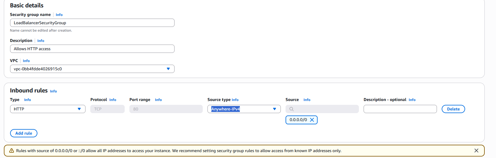

### 1.2 Launch Template Security Group (`LaunchTemplateSecurityGroup`)
Configured in the default VPC with inbound **HTTP (TCP port 80)** and **SSH (TCP port 22)** from `0.0.0.0/0` (`Anywhere-IPv4`) so the instances can serve web requests and accept SSH / EC2 Instance Connect connections.

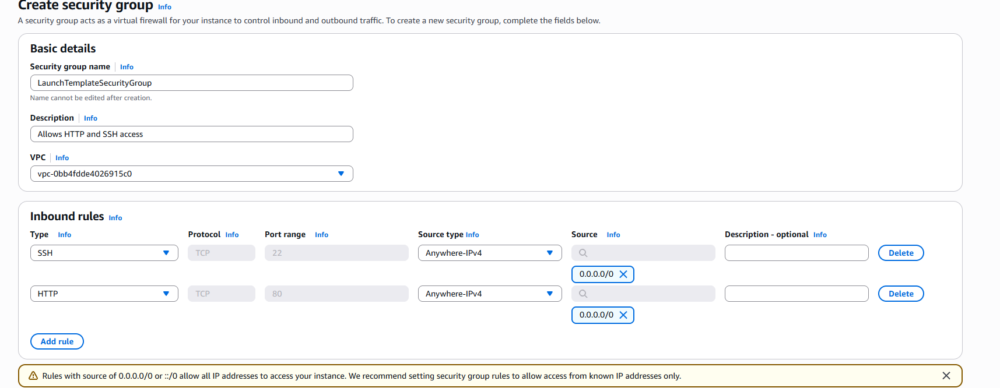

---

## Task 2 — Create a Target Group

I created an **Instances** target group named `LoadBalancerTargetGroup` using protocol **HTTP** on **port 80** in the default VPC, with HTTP health checks requesting path `/` every **30 seconds** (unhealthy threshold: **2** consecutive failed checks).

### 2.1 Target Group Details


### 2.2 Health Check Configuration

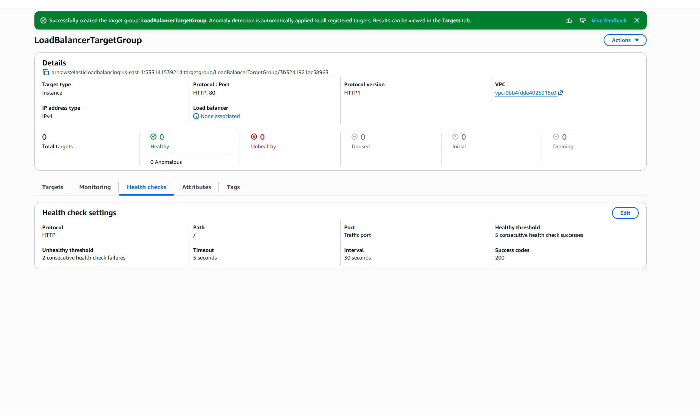

---

## Task 3 — Create an Application Load Balancer

I created an **Internet-facing** IPv4 Application Load Balancer named `MyLoadBalancer` mapped across all Availability Zones in the default VPC, attached `LoadBalancerSecurityGroup`, and configured an **HTTP:80** listener forwarding traffic to `LoadBalancerTargetGroup`.

### 3.1 Load Balancer Active in List

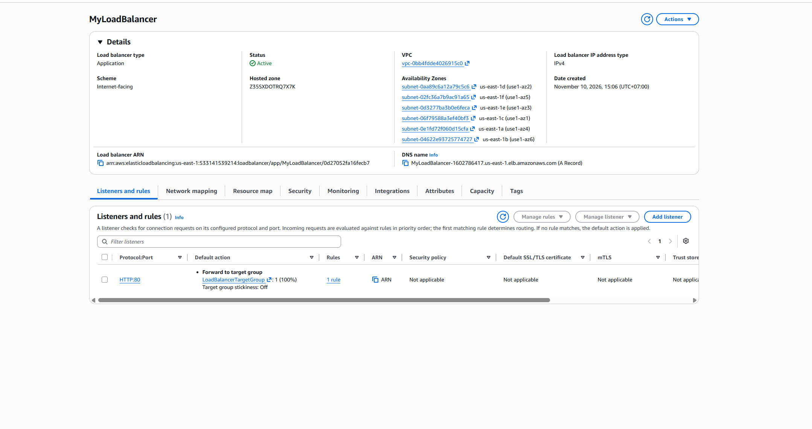

### 3.2 Load Balancer Details

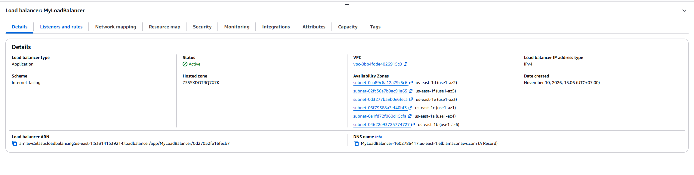

---

## Task 4 — Create an Auto Scaling Group

### 4.1 Launch Template (`AutoScalingLaunchTemplate`)
Configured with **Amazon Linux 2023 AMI**, instance type **`t2.micro`**, security group **`LaunchTemplateSecurityGroup`**, and the following User Data script to bootstrap Apache (`httpd`):

```bash
#!/bin/bash
# Enabling admin rights
sudo su
# Updating system and installing httpd
yum update -y
yum install -y httpd.x86_64
# Launching a simple httpd server
systemctl start httpd.service
systemctl enable httpd.service
# Writing HTML file to serve on the httpd server
echo "Hello World from ($(hostname))" > /var/www/html/index.html
```

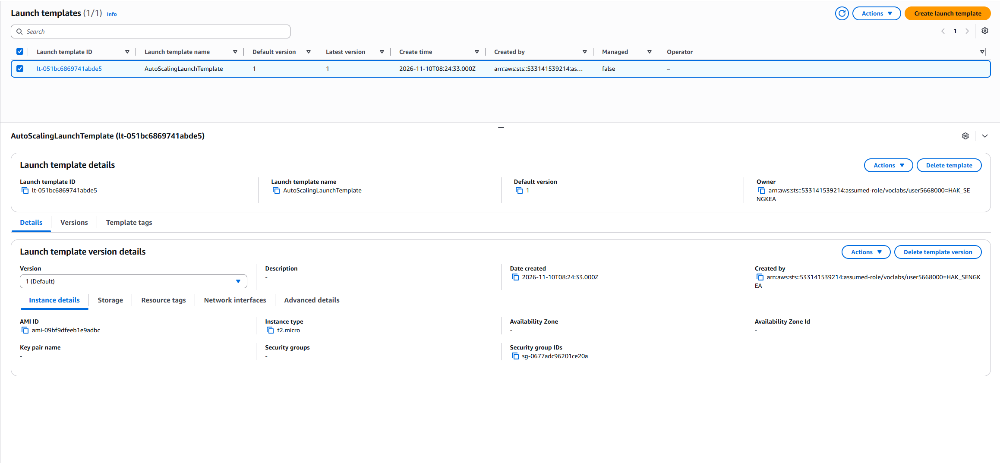

### 4.2 Auto Scaling Group (`MyAutoScalingGroup`)
Created `MyAutoScalingGroup` using `AutoScalingLaunchTemplate` across all Availability Zones in the default VPC, attached to `LoadBalancerTargetGroup` with **ELB health checks enabled**, and configured capacity settings:
- **Desired capacity:** `2`
- **Minimum capacity:** `2`
- **Maximum capacity:** `3`

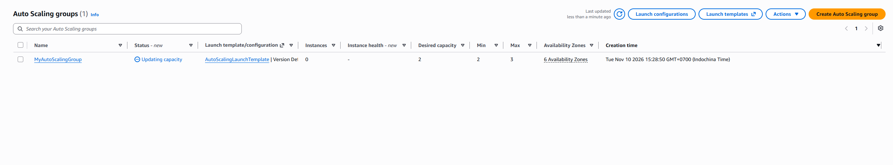

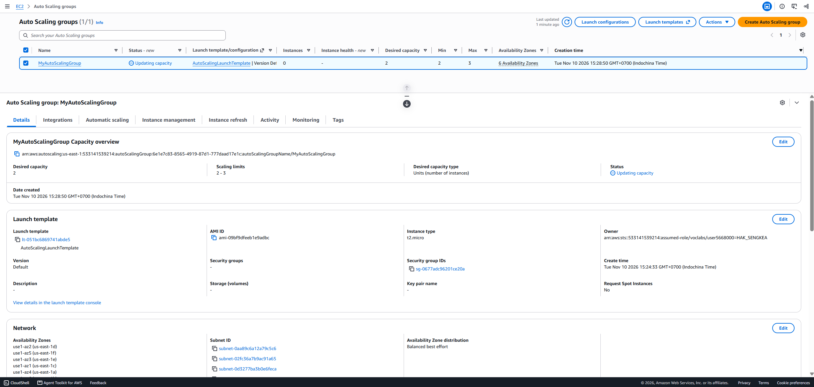

---

## Task 5 — Putting It All Together (Testing & Failover)

### 5.1 Load Balancing Across Multiple Instances
Accessing `http://<MyLoadBalancer-DNS>` in the browser and refreshing the page alternated responses between the two healthy EC2 instances in the Auto Scaling group:

**Instance 1 Response:**


**Instance 2 Response (after refresh):**


### 5.2 Simulating Application Failure
I connected to one of the running EC2 instances via **EC2 Instance Connect** and stopped the Apache web server:

```bash
sudo systemctl stop httpd.service
```

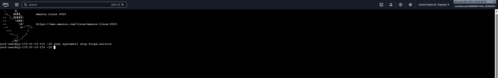

### 5.3 Unhealthy Target Detection & Automatic Replacement
After stopping `httpd.service`, the target failed two consecutive HTTP health checks on port 80 and transitioned to **Unhealthy** / **Draining**:

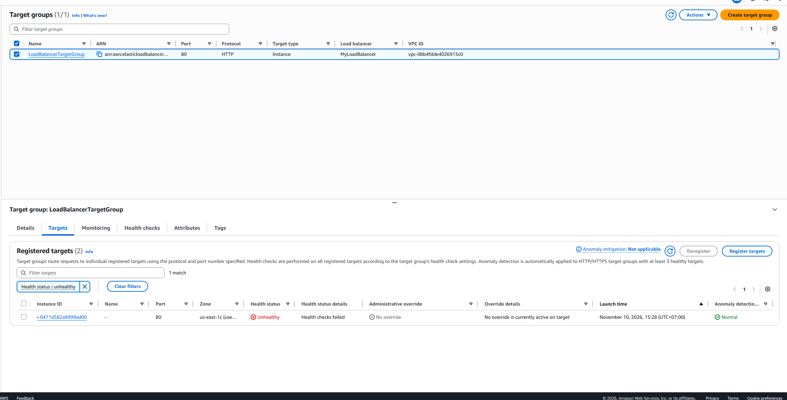

The Auto Scaling group automatically terminated the unhealthy instance and launched a replacement instance, which registered with `LoadBalancerTargetGroup` and passed health checks to become **Healthy**:

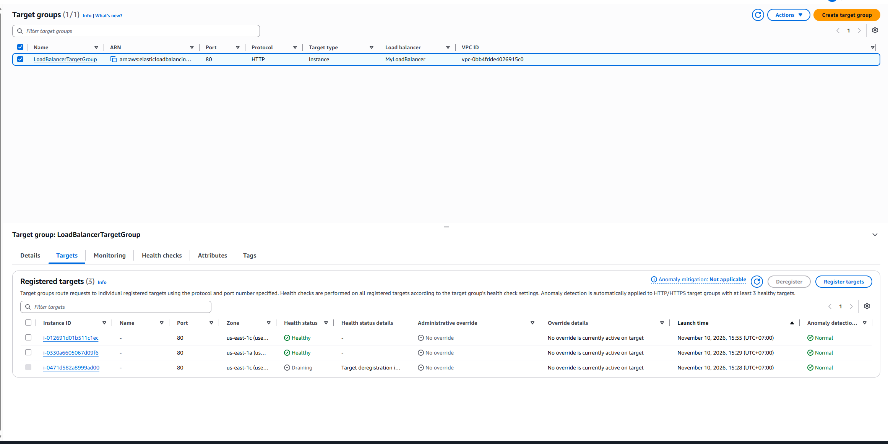

---

## Task 6 — Clean Up

After capturing all 14 screenshots, I cleaned up all resources in reverse order of creation:
1. Deleted `MyAutoScalingGroup` (which terminated all managed EC2 instances).
2. Deleted `AutoScalingLaunchTemplate`.
3. Deleted `MyLoadBalancer`.
4. Deleted `LoadBalancerTargetGroup`.
5. Deleted `LoadBalancerSecurityGroup` and `LaunchTemplateSecurityGroup`.

